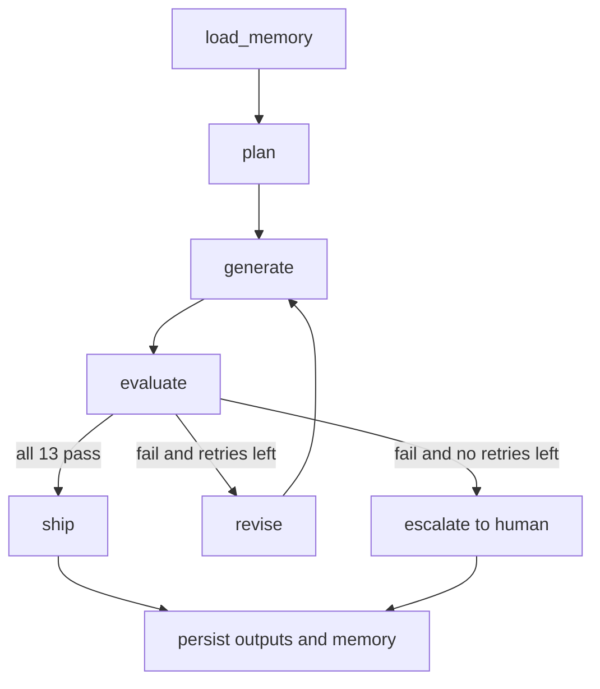

# Architecture and Design Decisions

## 1. The problem in one line

Do not write one clever prompt. Build a loop that decides, without a human, whether a lesson is good enough to ship, and that gets better over time.

## 2. Flow

| Node | Job |
| --- | --- |
| load_memory | Reads learned guidelines and the judge watch-list from earlier runs |
| plan | Creates an outline, an analogy and an example idea before any writing |
| generate | Writes the lesson. On a retry it also receives the previous draft and the failure reasons |
| evaluate | Runs 9 rule checks and 4 LLM-judged checks. Every check is pass or fail |
| revise | Turns each failure into a precise instruction and writes a rejection-log entry |
| ship | Marks the lesson as ready for a human |
| escalate | Used when retries run out. Sends the best draft to a human and marks it NOT shipped |
| persist | Writes all output files and updates memory |

## 3. Why these choices

**Plan, then write.** A separate planning step fixes the structure, the analogy and the example before the writing starts. This makes drafts more consistent and makes failures easier to trace.

**LangGraph.** The workflow is a state machine with a conditional loop. LangGraph makes the loop, the three exits and the shared state explicit and easy to inspect. A plain while-loop would work, but the graph is easier to explain and extend.

**Hybrid evaluator: rules first, model second.**
- Anything that can be measured is measured by code: reading grade, sentence length, banned words, section order, length, undefined jargon, unsupported years and numbers, known false claims. These checks are free, instant, repeatable and cannot be talked out of a verdict.
- Only judgement is given to the LLM: is every fact supported, is the example relatable, does the flow build, can a zero-background learner follow it. This keeps cost low and keeps the model honest.

**Hard pass or fail.** Each checkpoint has one clear threshold. A lesson ships only when all 13 pass. This removes the vague "score 7 out of 10" problem and makes the decision to ship auditable.

**Fail closed.** If the judge reply is not valid JSON, or one verdict is missing, the check counts as FAILED. A broken judge can never accidentally ship a bad lesson.

**Grounding.** The generator and the judge both receive the same reference facts. The rule checks also block any year or percentage that is not approved, and block known false claims. This targets the most common failure of generated educational content: confident, invented details.

**Separate judge settings.** The judge uses temperature 0 and can use a different model from the generator (`JUDGE_MODEL`). A model that grades its own output with the same settings tends to be too kind.

**Guaranteed termination.** The retry count is clamped to a maximum of 2, and the graph also has a recursion limit. The loop always ends in either `SHIPPED` or `NEEDS_HUMAN_REVIEW`.

**Feedback that can be acted on.** Each failure is sent back with the requirement, the reason, the exact evidence and a fix hint. The model is told to keep the parts that already passed. After the retry, the log records what was fixed, what still fails, what newly broke, the word count change and the text similarity.

## 4. Self-evolving and memory

Memory is a JSON file that survives between runs.

| What is stored | How it is used |
| --- | --- |
| Count of first-attempt failures per check | When a check fails first-attempt in 2 or more runs, its guideline is promoted into the generator prompt for every future run |
| The latest failure reasons per check | Shown to the judge as a watch-list so it looks for the same mistakes |
| Human feedback | Added to the generator prompt as reviewer feedback |
| Run history | Shipped or escalated, attempts used, promoted guidelines |

The effect: a mistake that keeps happening stops happening, because the prompt itself changes. The rubric is also sharpened over time through the judge watch-list.

## 5. Mapping to the assignment

| Assignment asks for | Where it lives |
| --- | --- |
| Generate a standalone beginner lesson | plan and generate nodes, `prompts.py` |
| Rubric of hard pass/fail checkpoints | `rubric.py`, `checks.py`, `judge.py` |
| Dimensions: accurate, beginner-friendly, example, jargon, coverage, flow | 13 checkpoints, see the README table |
| Regenerate on fail, max 1 or 2 retries | revise node, retry clamp in `config.py` |
| Output: passing lesson and rejection log | `reporting.py`, `rejection_log.md` and `.json` |
| Self-evolving | guideline promotion in `memory.py` |
| Memory across runs | `memory/store.json` |
| Stack | Python, LangGraph, Anthropic API |

## 6. Trade-offs and known limits

- Reading grade uses the Flesch-Kincaid formula with a syllable estimate. It is a good proxy, not a perfect measure of how an Indian learner reads English.
- The jargon check looks for a definition in the same or next sentence. It can miss a poor definition, which is why the LLM-judged STANDALONE check exists as a second layer.
- The LLM judge can still make mistakes. Fail-closed parsing and the rule layer reduce the risk but do not remove it. A human reviews every shipped lesson.
- Guideline promotion is count-based and simple. It does not yet remove guidelines that stop being useful.
- The offline mock model is a test double, not a real evaluation of model quality.

## 7. What I would build next

- Test the lesson with real learners and feed the quiz results into memory.
- Add a quiz-generation node with its own rubric.
- Retire guidelines that no longer help, and weight them by impact.
- Support more topics by loading a separate reference-facts file per topic.
